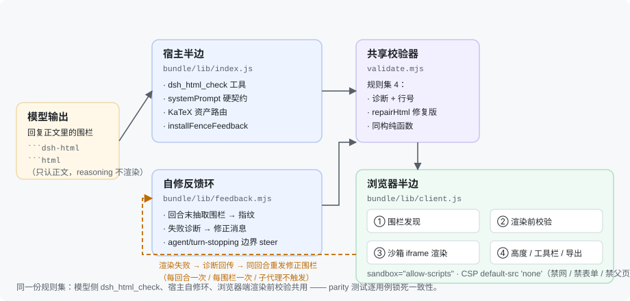

# dsh-html-ui

**English** | [中文](README.md)

[](LICENSE)
[](package.json)
[](https://github.com/zgxaxdd/dsh-html-ui)

**Make HTML inside model replies actually render in the chat stream.** Instead of showing a ```html fence
as a wall of source, `dsh-html-ui` takes it over and renders it for real inside a sandboxed iframe:
styles apply, interactions work, math typesets — with **zero network requests**.

## The problem it solves

DeepSeek Harness (DSH) renders ```html fences as ordinary code blocks. So even when the model can draw
a comparison table, a flow chart, or an interactive calculator, all you get is source code.

With this plugin installed, the same fence becomes a real page — plus a hover toolbar (source / preview /
open in new tab / copy / reload / **download a self-contained .html**).
## Capabilities

### v1.0.0 — baseline (deterministic takeover)

- ` ```html ` / ` ```dsh-html ` fences → sandboxed iframe: local scripts, block-level KaTeX, theme adaptation.
- **Event-driven height** (ResizeObserver + MutationObserver + `fonts.ready` + rAF double frame) — **no polling timers**.
- **Zero idle CPU**: nothing changes, nothing scans; the scheduler stops after quiet periods.
- Sandbox `allow-scripts` + CSP `default-src 'none'` (no network, forms, popups, or parent access); a single `$` is never treated as math.
- Toolbar, en/zh localization, accessibility.

### v2.0.0 — pre-render validation

- **Atomic validation** before mount: empty content, >1 MB, unclosed tags, stray closing tags — stable error
  codes with fix instructions.
- **last-good**: a failed re-render keeps the last successful render instead of blanking out.
- Multi-surface fence discovery + one-shot warning on host DOM drift; oversized input degrades to a source view.

### v3.0.0 — model-facing self-check

- **`dsh_html_check` tool**: the model validates a fence *before* emitting it and gets a receipt from the
  **same rule set** the browser renderer uses.
- Optional meta header `<!--dsh-html {"title":"…"}-->` (export filename / iframe name) and `{"full":true}`
  (full-page deliverable, line cap 250 → 500).
- Diagnostics bar with error-code badges + "copy repair prompt"; lazy rendering (off-screen fences are not mounted).

### v4.0.0 — repair loop

- **`repaired_html`**: the receipt carries the **fixed source**, so the model adopts a corrected version instead
  of rewriting from a description.
- **Same-turn fence repair** ⭐: at turn end the plugin validates the turn's fences and steers
  "diagnostics + repaired source" back into the **same turn**. Bounded: once per turn, once per fence
  (content fingerprint), never for sub-agents, cancellable. Disable with `{"fenceFeedback": false}`.
- `next` action table (`emit_fence` / `fix_warnings_then_emit` / `emit_repaired_html` / `fix_and_revalidate`).
- Rule set 4: diagnostics carry line numbers (`div@L12`), new `W-LINE-LIMIT` and `W-DOCTYPE`;
  unlabeled-code-block fallback tightened to a label whitelist.

### v4.1.0 — performance and edge cases (current)

- **Catastrophic backtracking eliminated**: `<a "` × k took **1633 ms** at 80 KB, `<!--` × k **203 ms** —
  all four regexes replaced with hand-written linear scanners. Same inputs now 4.1 / 0.1 / 1.7 / 1.1 ms;
  worst-case 1 MB ≤ 31 ms. Equivalence is backed by **4000 `validateRaw` + 1500 `repairHtml` differential
  cases against v4.0.0: 0 differences**.
- **Diagnostic line numbers** O(N × diagnostics) → O(N) + O(log N) (1 MB + 200 diagnostics: **153.4 ms → 4.1 ms**).
- **No full validation of unsettled blocks while streaming** (a 256 KB block used to burn 121 ms/s of main thread).
- **HTML5 self-closing semantics fixed**: `<div/>` is an open tag in HTML content — the old "repair" changed
  what got rendered.
- Tags inside comments/CDATA no longer misreported; fence extraction handles CRLF/CR and 4+ backticks;
  scan-budget exhaustion now reports `E-SCAN-LIMIT`.

Full measurements: [CHANGELOG.md](CHANGELOG.md) (Chinese) and [bundle/CHANGELOG.md](bundle/CHANGELOG.md).

## Install

```sh
# from npm (once published)
dsh plugin --profile web add dsh-html-ui

# local: link the bundle/ directory inside this repo (bundle/ is the plugin package)
dsh plugin --profile web add link:<absolute path to bundle inside this repo>

# uninstall
dsh plugin --profile web remove dsh-html-ui
```

Then **restart `dsh web`, hard-refresh the browser (Ctrl+F5), and open a new session.**

Verify: the console logs `[dsh-html-ui] client active; v4; …` and
`window.__dshHtmlUi.stats().version` reports the current version.

**Upgrading**: fence syntax is unchanged across v1–v4 — no existing fence needs editing.

## Writing fences

Fences must be written in the **reply body** — fences inside reasoning/thinking blocks are not rendered
(by design, not a bug).

Five hard rules:

1. Ship a compact `<style>` with the fence; use a **translucent neutral background** (e.g. `rgba(128,128,128,.08)`)
   and **never hard-code background or text color** — that is how light/dark themes blend automatically.
2. Scripts are **local to the fence only** (bind with `addEventListener`); **no** network calls, external libraries,
   iframes, parent access, or inline `onclick`.
3. Math is **block-level only**: `$$…$$` or `\[…\]`. A single inline `$…$` is not rendered (so prices stay intact).
4. Use `<mark>` for emphasis; prefer **inline SVG** for images (external images are not rendered).
5. Limits: ≤3 fences per reply, ≤250 lines each; a full-page deliverable may use ≤500 lines with
   `{"full":true}` in the meta header.

```dsh-html
<!--dsh-html {"title":"Fit cheat sheet"}-->
<div class="t">
  <style>
    .t{font:14px/1.7 -apple-system,"Segoe UI",Arial,sans-serif}
    .t table{border-collapse:collapse;width:100%;font-size:13px}
    .t th,.t td{border:1px solid rgba(128,128,128,.35);padding:5px 9px;text-align:left}
    .t .k{font-family:ui-monospace,Consolas,monospace;color:#3b82f6}
  </style>
  <table>
    <tr><th>Fit</th><th>Hole H7</th><th>Shaft g6</th><th>Type</th></tr>
    <tr><td class="k">H7/g6</td><td>+0.021/0</td><td>−0.009/−0.020</td><td>clearance</td></tr>
  </table>
  <p>Key values use <mark>monospace</mark>; dark mode adapts automatically.</p>
</div>
```

Paste-ready examples live in [`examples/`](examples/). The full authoring protocol (style library A–E,
error-code table, `next` action table) is in
[bundle/skills/dsh-html-ui/SKILL.md](bundle/skills/dsh-html-ui/SKILL.md) (Chinese).

## Architecture



- **Host half** `bundle/lib/index.js`: registers the `dsh_html_check` tool, injects the system-prompt contract
  (562 chars; details load on demand from SKILL.md), routes KaTeX assets, installs the repair loop.
- **Shared validator** `bundle/lib/validate.mjs`: isomorphic pure functions, rule set 4. The model-facing tool,
  the host repair loop, and the browser's pre-render check all use the **same** implementation — the client
  embeds a copy kept in sync by `test/embed-validate.mjs` and locked by `test/parity.test.mjs`.
- **Client half** `bundle/lib/client.js`: fence discovery (multi-surface + whitelist fallback) → validation →
  sandboxed iframe render → height `postMessage` (strict `ev.source` pairing) → toolbar / export / diagnostics bar.
- **Repair loop** `bundle/lib/feedback.mjs`: extracts the turn's fences → content fingerprint → diagnostics →
  steers a correction message at the `agent/turn-stopping` boundary.
- **Security boundary**: inner iframe `sandbox="allow-scripts"`, CSP `default-src 'none'`, exported files reuse
  the same CSP. See [SECURITY.md](SECURITY.md).

## Repository layout

| Path | Role |
|---|---|
| **`bundle/`** | **Source of truth for deployment** — the DSH plugin package and the only npm publish target |
| `skills/dsh-html-ui/SKILL.md` | Marketplace mirror, byte-identical to the copy in `bundle/` |
| `docs/` | Design docs and the architecture diagram |
| `examples/` | Fences you can paste straight into a DSH session |
| `src/` `tools/` `test/` `e2e/` | v1.0.0-era sources, esbuild chain, vitest, Playwright (kept for history) |
| `vendor/katex/` | Upstream pinned copy of the KaTeX assets: input to the v1 build chain and the integrity-check target of `tools/verify-sha256sums.mjs`. The browser loads `bundle/lib/assets/katex/` |

## Development

```sh
npm run check        # syntax check for 4 modules (index / client / validate / feedback)
npm test             # 7-step regression suite
npm run verify:pack  # real-tarball pack self-check (required files / exports / size caps)
```

`npm test` runs 7 files: `test/embed-validate.mjs --check`, `test/fence.test.mjs`, `test/feedback.test.mjs`,
`test/validate.test.mjs`, `test/parity.test.mjs`, `test/load.test.mjs`, `test/client-apply.test.mjs`.

**Changing validation rules**: edit `bundle/lib/validate.mjs` → run `node bundle/test/embed-validate.mjs`
(syncs the embedded copy in `client.js`) → `npm test`. Never hand-edit the section between
`// src/validate.js` and `// src/kernel.js` in `client.js`. See [CONTRIBUTING.md](CONTRIBUTING.md) (Chinese).

Debug API: `window.__dshHtmlUi.stats()` / `.validate(raw)` / `.repair(raw)`.

## Security

This plugin renders **untrusted, model-generated HTML**. Fence content runs in an inner
`sandbox="allow-scripts"` iframe (no `allow-same-origin`); CSP `default-src 'none'` blocks network, forms,
popups, and parent access; everything passes the validator first, and oversized input degrades to a source view.
**Residual risks and the reporting channel are in [SECURITY.md](SECURITY.md)** — please do not paste
directly exploitable PoCs into public issues.

## Third-party

**KaTeX 0.18.5** (MIT, Copyright (c) 2013-2020 Khan Academy and other contributors) ships in
`bundle/lib/assets/katex/`. See [NOTICE](NOTICE).

## License

[MIT](LICENSE) · Copyright (c) 2026 zgxaxdd
